

<a href="https://joshuasalvacion.dev" title="Explore Joshua's portfolio">
  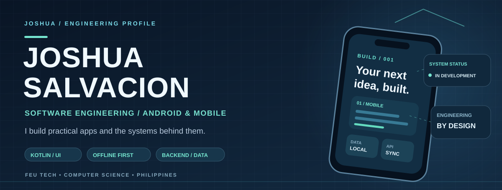
</a>

**Fourth-year BS Computer Science · Major in Software Engineering · FEU Institute of Technology**

 

<a href="#about"><kbd> 01 · ABOUT </kbd></a> &nbsp; <a href="#builds"><kbd> 02 · BUILDS </kbd></a> &nbsp; <a href="#toolkit"><kbd> 03 · TOOLKIT </kbd></a> &nbsp; <a href="#milestones"><kbd> 04 · MILESTONES </kbd></a> &nbsp; <a href="#connect"><kbd> 06 · CONNECT </kbd></a>

---

### 01 / About the builder

I'm **Joshua Salvacion**, a software engineering student who enjoys translating real problems into working applications. My main focus is **native Android development with Kotlin and Jetpack Compose**, supported by experience with **React Native, backend APIs, databases, and automated testing**.

The ideas I gravitate toward have something in common: they should remain useful under real-world constraints—limited connectivity, local data, clear permissions, and understandable behavior.

> **My approach:** design around the user's problem, build the smallest meaningful workflow, and document what the software *actually* does.

<strong>↳ What I'm learning and working toward</strong>

- **Mobile engineering:** native Android UI, state, persistence, device testing, and offline-first architecture.
- **Backend reliability:** APIs, authentication boundaries, PostgreSQL workflows, validation, and migrations.
- **Product thinking:** turning research and prototypes into implementable features with clear limitations.
- **Next chapter:** software engineering internship opportunities, especially Android/mobile development.

### 02 / Selected builds

**Three primary projects** — also featured in my pinned repositories.

  <a href="https://github.com/slvcn-jsh/PCOSina" title="Explore PCOSina source">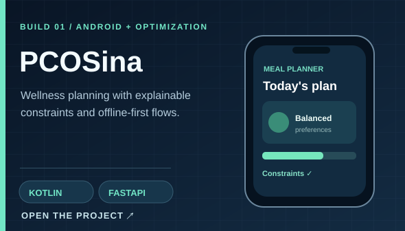</a>
  <a href="https://github.com/slvcn-jsh/barion" title="Explore Barion source">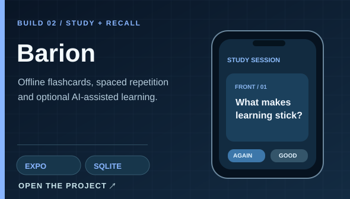</a>

  <a href="https://github.com/slvcn-jsh/FocusLoop" title="Explore FocusLoop source">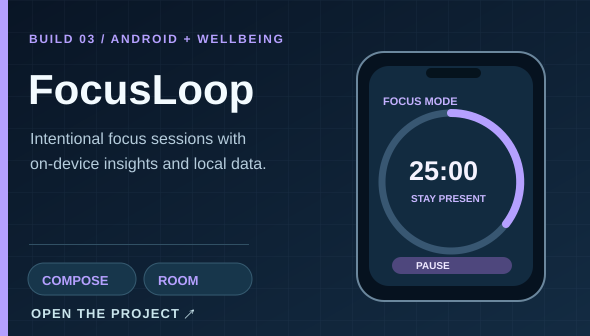</a>
  <a href="https://joshuasalvacion.dev/projects/freshkeep" title="Explore FreshKeep case study">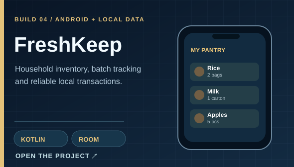</a>

**More systems and workflows** — explored through the portfolio case studies.

  <a href="https://joshuasalvacion.dev/projects/resolveops" title="Explore ResolveOps case study">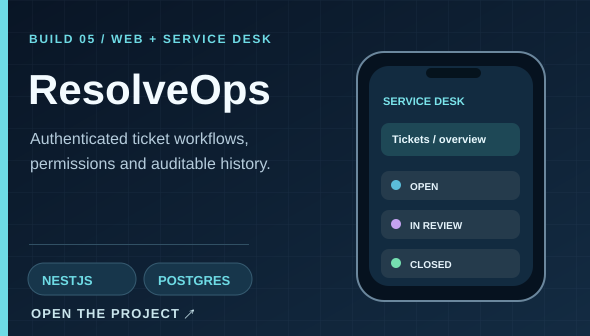</a>
  <a href="https://joshuasalvacion.dev/projects/procura" title="Explore Procura case study">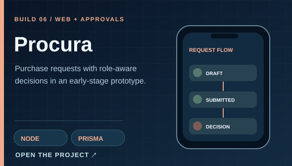</a>

  The cards above are original conceptual illustrations. Below are actual project screenshots published with my portfolio.

<strong>📱 View actual application screens — PCOSina, Barion & FocusLoop</strong>

 

  
  
  

  <a href="https://joshuasalvacion.dev/projects/pcosina"><strong>PCOSina</strong></a> &nbsp; · &nbsp;
  <a href="https://joshuasalvacion.dev/projects/barion"><strong>Barion</strong></a> &nbsp; · &nbsp;
  <a href="https://joshuasalvacion.dev/projects/focusloop"><strong>FocusLoop</strong></a>

These are existing portfolio screenshot assets, not synthetic mockups. Open each case study for full-resolution views and context.

<strong>🔍 Open the engineering field notes — what makes each project interesting?</strong>

| Project | Engineering focus | Project evidence |
| :-- | :-- | :-- |
| **PCOSina** | Kotlin/Compose Android client; FastAPI services; rule-based and OR-Tools meal planning with optional ML-assisted ranking and deterministic guardrails | [Case study](https://joshuasalvacion.dev/projects/pcosina) |
| **Barion** | React Native/Expo learning workflows; offline SQLite persistence, spaced repetition, and optional Python-based AI gateway | [Case study](https://joshuasalvacion.dev/projects/barion) |
| **FocusLoop** | Android focus sessions, usage access boundaries, Room persistence, and privacy-conscious local data | [Case study](https://joshuasalvacion.dev/projects/focusloop) |
| **FreshKeep** | Local inventory transactions, independent batches, quantity adjustments, and Android device testing | [Case study](https://joshuasalvacion.dev/projects/freshkeep) |
| **ResolveOps** | Authenticated service-desk tickets, permissions, lifecycle safeguards, and database-backed history; locally tested prototype | [Case study](https://joshuasalvacion.dev/projects/resolveops) |
| **Procura** | Roles, sessions, purchase requests, submissions, and manager decisions; early-stage prototype | [Case study](https://joshuasalvacion.dev/projects/procura) |

**Source visibility:** PCOSina, Barion, and FocusLoop have public repositories. The other three projects are documented in portfolio case studies; source access is not implied.

### Verified engineering signals

  
  &nbsp;
  

  Live coverage data is from <a href="https://github.com/slvcn-jsh/PCOSina/tree/dev">PCOSina's Python backend on <code>dev</code></a>, not the Kotlin Android client or the full repository. The CI link opens the test workflow; the badge reflects Codecov's published report.

### 03 / The toolkit

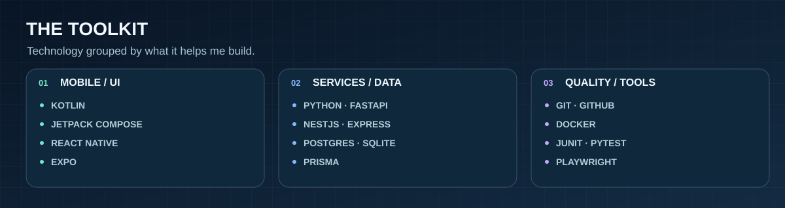

**Languages:** `Kotlin` · `Python` · `TypeScript` · `SQL` · `Java (studied)`

**Practices:** Offline-first design · REST APIs · Local persistence · Automated tests · CI checks

<strong>⚙️ See how the pieces fit together</strong>

| Layer | Examples from my work |
| :-- | :-- |
| **Interface** | Jetpack Compose for native Android; React Native/Expo for cross-platform mobile; React for web |
| **Application logic** | Kotlin domain layers; Python FastAPI services; NestJS/Express workflow logic |
| **Persistence** | Room + SQLite for local-first apps; PostgreSQL + Prisma for transactional web systems |
| **Verification** | JUnit/Android instrumentation, pytest, Jest, Vitest, Playwright and documented checks |

I value tools for the problems they solve—not for how many logos fit on a page.

### 04 / Milestones, recognition & learning

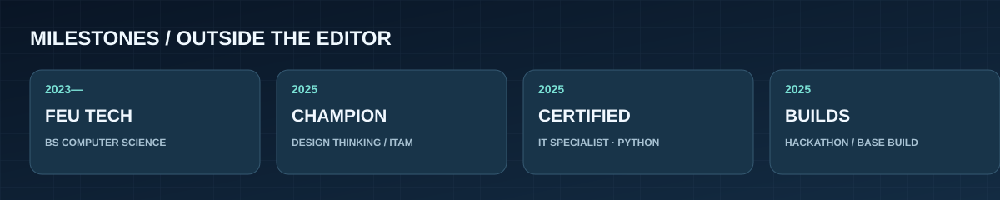

- 🏆 **Champion** — FEU Tech Design Thinking Summit and ITAM Design Jam, March 2025.
- 📜 **IT Specialist — Python** — Certiport, 2025.
- 🧭 **Learning beyond coursework** — HACKathon 2025 at UP Manila and BASE BUILD Global Buildathon 2025 at Adamson University.

<strong>📖 More education, training and background</strong>

- **BS Computer Science, major in Software Engineering** — FEU Institute of Technology (August 2023–present).
- **Positioning the Autonomous Enterprise** — training, 2026.
- **AI Prompt Design Bootcamp** — National AI Prompt Design Challenge Philippines, 2025.

Explore my [about page](https://joshuasalvacion.dev/about), [skills](https://joshuasalvacion.dev/skills), or [résumé](https://joshuasalvacion.dev/resume) for more context.

### 05 / Public development activity

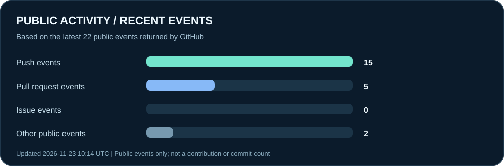

Generated from GitHub's public events feed using a [weekly GitHub Actions workflow](.github/workflows/public-activity.yml). Event counts are not commit counts, private activity, or a measure of code quality.

### 06 / What's next?

<a href="https://joshuasalvacion.dev">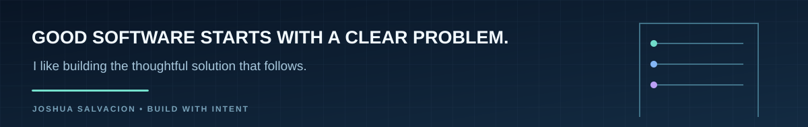</a>

I'm interested in **software engineering internships**, particularly **Android/mobile development** and the backend systems that support real applications.

**[Explore my case studies](https://joshuasalvacion.dev/projects)** · **[Connect on LinkedIn](https://www.linkedin.com/in/joshua-salvacion/)** · **[Contact me](https://joshuasalvacion.dev/contact)**

Designed as a readable, low-dependency GitHub profile. Project graphics illustrate concepts; they are not screenshots, benchmarks, release claims, or live demos.

 

<a href="#top">↑ Back to top</a>

